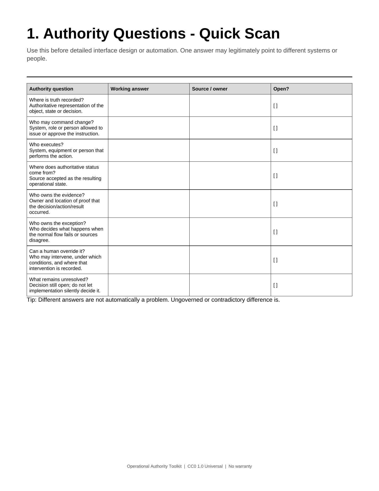
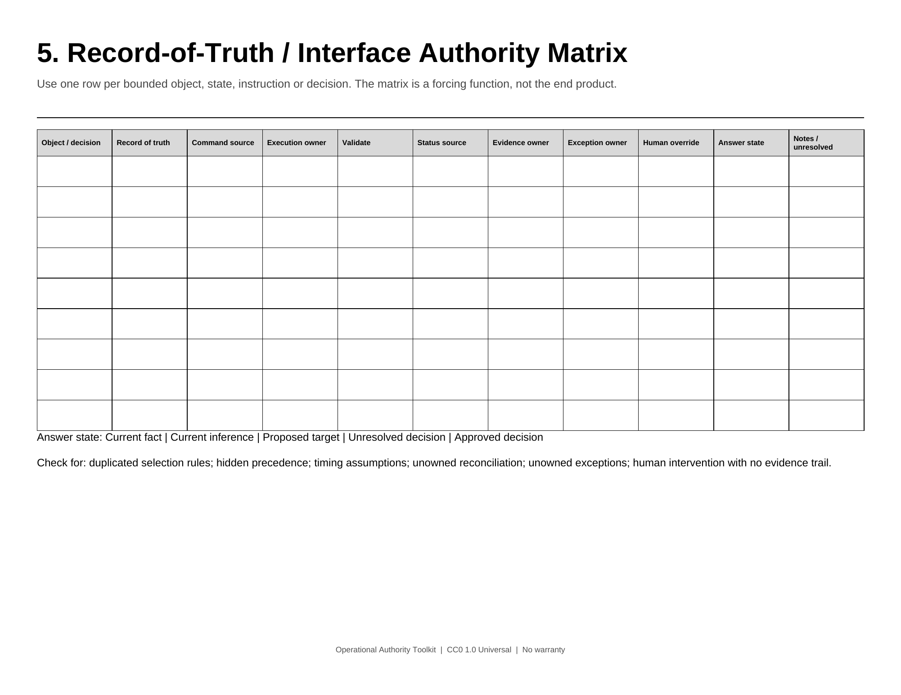
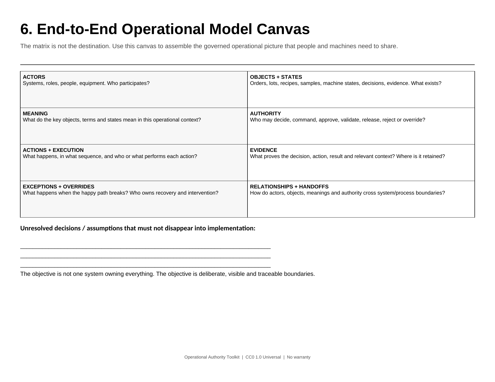

# Operational Authority Toolkit

**When ERP, MES, automation, procedures, and people disagree, who is allowed to be right?**

The Operational Authority Toolkit is a free, unbranded set of field templates for making **meaning, authority, evidence, and exceptions explicit before detailed automation**.

Use it when a process works in practice, but the operational truth is scattered across systems, interfaces, procedures, tribal knowledge, and sensible human workarounds.

**Free. No signup. No attribution required. Released under CC0 1.0 Universal.**

> This toolkit is a practical companion to the article **Operational Truth in the Age of AI**. It is not an industry standard, an ATS methodology, a certification scheme, or a substitute for your own engineering, safety, quality, legal, or validation controls.

## Experimental portable Agent Skills — v0.3 (draft)

An optional, fully separate [portable skills package](portable-skills/README.md) provides two vendor-neutral `SKILL.md` capabilities: [OT Discovery](portable-skills/skills/ot-discovery/SKILL.md) and [Solution Architecture & ROM](portable-skills/skills/solution-architecture-rom/SKILL.md). v0.3 adds shared-resource/time modelling, contested approval-policy tests, and ROM revision/supplier overlap reconciliation. Its [change history](portable-skills/CHANGELOG.md), [offline synthetic checks](portable-skills/experiments/RESULTS-v03.md), and [peer-trial plan](portable-skills/experiments/PEER-TRIAL.md) remain **experimental**. No independent model-competence or field-safety validation is implied. The skills are not an official consultancy method or a replacement for this toolkit.

The legacy PDF/DOCX/XLSX/ZIP links below remain pinned to their existing immutable artifacts; `SHA256SUMS.txt` applies to those distributed artifacts, **not** the current working-tree skills. The draft skills package includes only original CC0 material and fictional examples, plus Python standard-library offline validation scripts; it is not an OT runtime.

## Start here

If you only have 15 minutes, use the **Authority Questions - Quick Scan**.

If you are designing or fixing an interface, use the **Interface Authority Decision Record** and **Record-of-Truth / Interface Authority Matrix**.

If the real problem is bigger than one interface, use the **End-to-End Operational Model Canvas**.

## What problem does this solve?

Many architectures document **where data moves** without making equally explicit:

- what a value means in operational context;
- which actor or system may define, command, validate, override, or evidence it;
- what happens when two sources disagree;
- which exceptions are permitted;
- what remains true after a manual intervention, workaround, or partial failure.

That ambiguity is survivable while experienced people keep the process coherent. Automation and AI make it easier to scale the ambiguity too.

The toolkit gives teams a small set of practical artefacts for exposing those decisions before they disappear into code, interfaces, workflow logic, or memory.

## What is in the pack

- **Authority Questions - Quick Scan** - expose unresolved ownership and authority questions early.
- **Six-Verbs Authority Worksheet** - Define, Authorize, Execute, Validate, Evidence, Override.
- **State of the Answer** - distinguish current fact, current inference, proposed target, unresolved decision, and approved decision.
- **Interface Authority Decision Record** - capture one bounded interface or operational decision with its authority and evidence boundaries.
- **Record-of-Truth / Interface Authority Matrix** - working matrix for truth, command, execution, validation, status, evidence, exceptions, and override.
- **End-to-End Operational Model Canvas** - step beyond the worksheet toward the actual target: a coherent operational model.
- **Pre-Automation Authority Check** - a short gate before more operational action is delegated.

## Downloads

The links below bypass GitHub's document-preview page and are pinned to the immutable artifact commit `b277752`.

| Need | Download |
| --- | --- |
| Print / workshop | [Download PDF](https://github.com/Apathyte/operational-authority-toolkit/raw/b277752fe39713c05b1ff0cb9a70e34424883488/print/Operational_Authority_Toolkit_CC0.pdf) |
| Edit the full pack | [Download DOCX](https://github.com/Apathyte/operational-authority-toolkit/raw/b277752fe39713c05b1ff0cb9a70e34424883488/editable/Operational_Authority_Toolkit_CC0.docx) |
| Work directly in a matrix | [Download XLSX](https://github.com/Apathyte/operational-authority-toolkit/raw/b277752fe39713c05b1ff0cb9a70e34424883488/workbook/Record_of_Truth_Interface_Authority_Matrix_CC0.xlsx) |
| Take everything | [Download ZIP](https://github.com/Apathyte/operational-authority-toolkit/raw/b277752fe39713c05b1ff0cb9a70e34424883488/bundle/Operational_Authority_Toolkit_CC0.zip) |

## Use it like a working tool

Choose the page that helps. Change the language. Remove fields. Add domain controls. Replace the matrix entirely if your existing architecture or decision-record practice captures the same information better.

The objective is not to complete a framework. The objective is to leave enough of the operational model explicit that systems, current teams, and the people who inherit the work later do not have to reconstruct authority from code, interfaces, or memory.

The matrix is therefore not the end product. The end goal is a coherent end-to-end operational model in which the relevant actors, objects, states, relationships, meanings, authorities, actions, evidence, and exceptions are explicit enough to be understood consistently.

## Example situations

This toolkit is useful when:

- ERP says one lot was planned, MES says another state was executed, and the shop floor made a sensible substitution;
- an interface moves a field successfully, but nobody can state which system owns its meaning;
- a manual override is allowed operationally but poorly represented in the digital model;
- an automation project is about to encode assumptions that have never been approved explicitly;
- an AI or agent is being given operational action without a clear authority boundary.

## Preview

### Authority quick scan

### Record-of-Truth / Interface Authority Matrix

### End-to-End Operational Model Canvas

## Trust, safety, and integrity

The original toolkit downloads contain **documents and templates**. The optional experimental `portable-skills/tests/` directory contains **executable Python offline validators** for synthetic fixtures, not production automation. Review the scripts before running them; they require no credentials or OT connections. Treat all editable materials as working documents and review them before use in controlled environments.

Published artifacts have SHA-256 hashes in [`SHA256SUMS.txt`](SHA256SUMS.txt). The download links above are pinned to the immutable artifact commit so the files behind a shared link do not silently change.

For security reporting and repository-specific trust notes, see [`SECURITY.md`](SECURITY.md).

## License

Released under **CC0 1.0 Universal**. No attribution is required. Copy it, adapt it, redistribute it, put your own branding on it, or build something better.

Canonical CC0 legal code: https://creativecommons.org/publicdomain/zero/1.0/legalcode

## Integrity

`SHA256SUMS.txt` contains SHA-256 hashes for the distributed artifacts.
